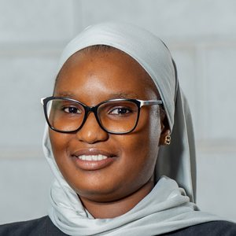

<!-- ===================== BANNIÈRE ===================== -->
<p align="center">
  
</p>

<p align="center">
  <a href="https://ndiayeamanatou.github.io">
    
  </a>
</p>

<p align="center">
  <a href="https://ndiayeamanatou.github.io"></a>
  <a href="https://www.linkedin.com/in/yaye-amanatou-ndiaye-6702b0337/"></a>
  <a href="mailto:amma03.ndiaye@gmail.com"></a>
  
</p>

---

## 👩🏾‍💻 À propos de moi



Hi there! 👋 Je suis **Amanatou Ndiaye**, diplômée d'une **Licence en Ingénierie Informatique** de l'Université Assane Seck de Ziguinchor (**UASZ**). Actuellement, je poursuis une formation en **Intelligence Artificielle** à la **Sonatel Academy – École du Code d'Orange Digital Center**.

Passionnée par le numérique, l'innovation et les nouvelles technologies, je m'intéresse particulièrement à l'**Intelligence Artificielle**, à la **Data Science** et au développement de solutions technologiques. Curieuse et animée par l'envie d'apprendre, j'aime relever des défis, explorer de nouvelles idées et transformer les connaissances en solutions concrètes à impact positif.

Mon ambition : contribuer à un écosystème numérique **innovant, inclusif et porteur de changement**, particulièrement en **Afrique** 🌍.

```python
class Amanatou:
    location   = "Dakar, Sénégal 🇸🇳"
    roles      = ["Data Analyst", "Data Scientist Junior", "ML Engineer", "Développeuse Web"]
    education  = ["CPS Référent IA — Sonatel Academy / Orange Digital Center (2026 → …)",
                  "Licence Ingénierie Informatique — UASZ (2022 – 2026)"]
    languages  = ["Français 🇫🇷", "English 🇬🇧", "Wolof 🇸🇳"]
    focus      = ["LLM & RAG", "Machine Learning", "Deep Learning", "Data Viz"]
    motto      = "Transformer les données en impact 🚀"
```

<details>
<summary>🇬🇧 <b>English version</b></summary>
<br/>

I'm **Amanatou Ndiaye**, holder of a **Bachelor's degree in Computer Engineering** from Assane Seck University of Ziguinchor (UASZ), currently pursuing an **Artificial Intelligence** program at **Sonatel Academy – Orange Digital Center's Coding School**. I'm passionate about **AI**, **Data Science** and building tech solutions with a positive impact — especially in **Africa** 🌍.
</details>

---

## 🛠️ Stack technique

<p align="center">
  <br/>
  <br/>
  
</p>

<p align="center">
  
  
  
  
  
  
  
  
  
  
  
</p>

---

## 🚀 Projets à la une

<table>
<tr>
<td width="50%" valign="top">

### 🛡️ [Pipeline RAG — Cybersécurité](https://github.com/NdiayeAmanatou/Atelier_pratique_LLM)
Ingestion de PDF, nettoyage, chunking (1 500 car. / 15 % de chevauchement), embeddings et base vectorielle **ChromaDB** pour la recherche sémantique par un LLM.

`Python` `LLM` `RAG` `ChromaDB`
</td>
<td width="50%" valign="top">

### 💼 [AI Business Assistant](https://github.com/NdiayeAmanatou/IA_business_assistant)
Prompt engineering appliqué à l'analyse des retours clients : anatomie d'un prompt, benchmark **zero / one / few-shot**.

`LLM` `Prompt Engineering` `NLP`
</td>
</tr>
<tr>
<td valign="top">

### ⚡ [Prédiction de consommation énergétique](https://github.com/NdiayeAmanatou/atelier_tensorflow_1)
Réseau de neurones **TensorFlow/Keras** prédisant la consommation d'un bâtiment intelligent à partir de capteurs IoT.

`TensorFlow` `Keras` `Deep Learning`
</td>
<td valign="top">

### 📡 [Classification de capteurs IoT](https://github.com/NdiayeAmanatou/atelier_scikit_learn)
Modèle **KNN** prédisant l'état d'un capteur : standardisation, split stratifié, matrice de confusion.

`scikit-learn` `KNN` `ML`
</td>
</tr>
<tr>
<td valign="top">

### ☁️ [API Spring Boot sur AWS](https://github.com/NdiayeAmanatou/deploy_api_aws)
API REST en **Java / Spring Boot** préparée pour un déploiement dans le cloud **AWS**.

`Java` `Spring Boot` `AWS`
</td>
<td valign="top">

### 🧩 [AI Workspace — Dashboard web](https://github.com/NdiayeAmanatou/Atelier_technos_web_IA)
Tableau de bord web responsive pour un espace de travail IA.

`HTML` `CSS` `JavaScript`
</td>
</tr>
</table>

<details>
<summary>📂 <b>Voir tous mes ateliers Data Science</b></summary>
<br/>

| Projet | Description | Stack |
|---|---|---|
| [Préparation de données tabulaires](https://github.com/NdiayeAmanatou/atelier_preparation_donnees) | Dataset Smart Building prêt pour le ML (Pipeline, One-Hot, scaling) | Pandas · scikit-learn |
| [Préparation de données images](https://github.com/NdiayeAmanatou/Atelier_prepa_donnees_images) | Nettoyage, resize, augmentation, split train/val/test | PIL · NumPy |
| [Préparation de données textuelles](https://github.com/NdiayeAmanatou/Atelier_prepa_donnees_textuelles) | Lemmatisation, stopwords, TF-IDF pour l'analyse de sentiment | NLP · TF-IDF |
| [Pandas IoT](https://github.com/NdiayeAmanatou/pandas_atelier) | Nettoyage et analyse de mesures de capteurs | Pandas |
| [NumPy IoT](https://github.com/NdiayeAmanatou/atelier-numpy-iot) | Calculs vectorisés et statistiques | NumPy |
| [Matplotlib IoT](https://github.com/NdiayeAmanatou/atelier_matplotlib) | Visualisation des températures | Matplotlib |
| [Seaborn IoT](https://github.com/NdiayeAmanatou/atelier_seaborn) | 15+ visualisations statistiques | Seaborn |
| [Dataset Manager](https://github.com/NdiayeAmanatou/datasetManager) | App Python modulaire de gestion de datasets | Python · CSV/JSON |

</details>

---

## 📊 Statistiques GitHub

<p align="center">
  
  
</p>
<p align="center">
  
</p>
<p align="center">
  
</p>

---

<p align="center">
  <i>« Transformer les connaissances en solutions concrètes à impact positif. »</i> ✨
</p>


