


 

 

Hi there! 👋 Je suis <b>Amanatou Ndiaye</b>, diplômée d'une <b>Licence en Ingénierie Informatique</b> de l'Université Assane Seck de Ziguinchor (<b>UASZ</b>) et actuellement en formation <b>CPS Référent IA</b> à la <b>Sonatel Academy – École du Code d'Orange Digital Center</b>.

Passionnée par l'<b>Intelligence Artificielle</b>, la <b>Data Science</b> et le développement de solutions technologiques, j'aime relever des défis, explorer de nouvelles idées et transformer les connaissances en <b>solutions concrètes à impact positif</b> — avec une ambition : contribuer à un écosystème numérique <b>innovant, inclusif et porteur de changement</b> en Afrique 🌍.

  
  

🇬🇧 <b>Read in English</b>

 
I'm <b>Amanatou Ndiaye</b>, holder of a <b>Bachelor's degree in Computer Engineering</b> (UASZ), currently enrolled in the <b>AI Referent</b> specialization program at <b>Sonatel Academy – Orange Digital Center</b>. Passionate about <b>AI</b>, <b>Data Science</b> and building tech solutions with real impact — especially in <b>Africa</b> 🌍. Open to internships, opportunities and collaborations!

 


  

 


   
  

  

 


  <a href="https://github.com/NdiayeAmanatou/Atelier_pratique_LLM"></a>
  <a href="https://github.com/NdiayeAmanatou/IA_business_assistant"></a>
  <a href="https://github.com/NdiayeAmanatou/atelier_tensorflow_1"></a>
  <a href="https://github.com/NdiayeAmanatou/atelier_scikit_learn"></a>
  <a href="https://github.com/NdiayeAmanatou/deploy_api_aws"></a>
  <a href="https://github.com/NdiayeAmanatou/Atelier_technos_web_IA"></a>

  

 


  
  

  

  

  <picture>
    <source media="(prefers-color-scheme: dark)" srcset="https://raw.githubusercontent.com/NdiayeAmanatou/NdiayeAmanatou/output/github-contribution-grid-snake-dark.svg" />
    
  </picture>

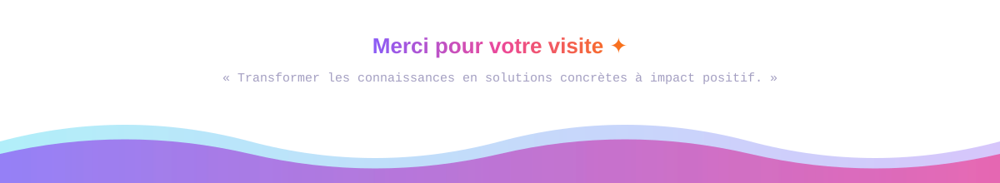

  

